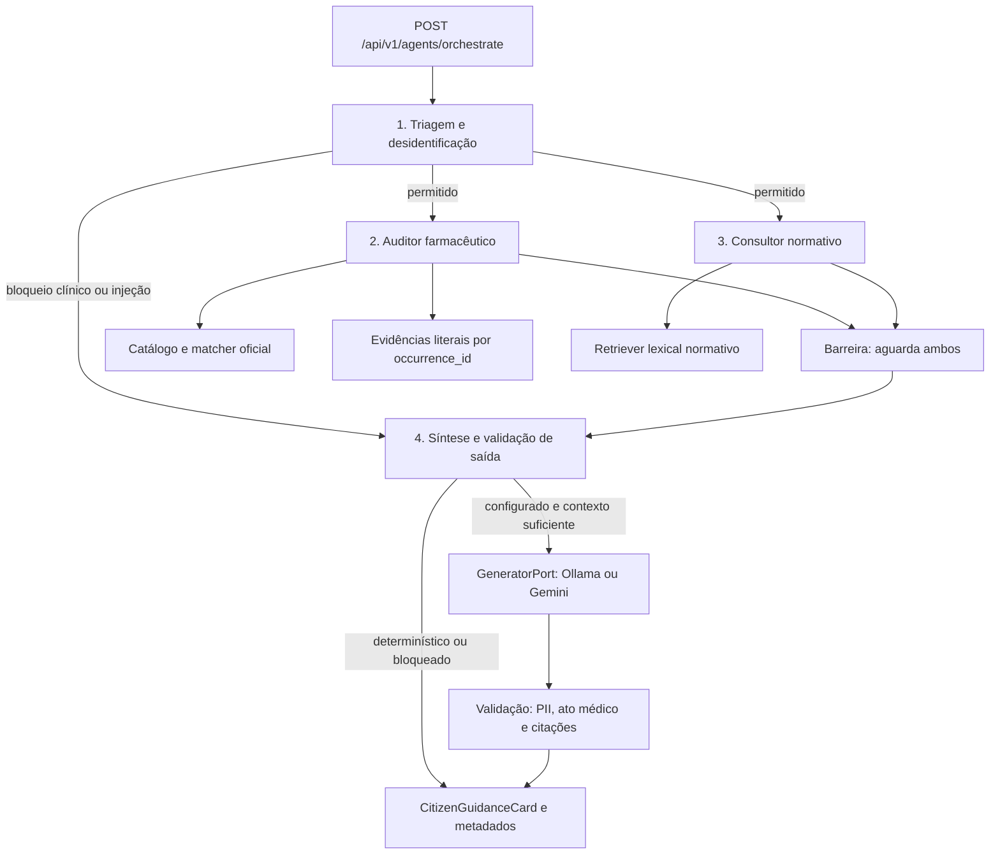

# Agentes da Semana 4 — guia de implementação e operação

Esta versão entrega backend, API, CLI e colaboração de quatro componentes. A
geração real é configurável; a qualidade científica do novo fluxo está **PENDENTE**.
O padrão offline é determinístico e sua resposta nunca é apresentada como inferência.

## Fluxo e responsabilidades



| Agente | O que executa | Ferramentas/portas | O que entrega |
| --- | --- | --- | --- |
| 1. Triagem | Inspeciona cada campo, prioriza emergência entre todos os bloqueios e mascara PII antes dos demais nós | `GuardrailPort`, `inspect_request`, `sanitize_request` | Pedido sanitizado ou alerta, sem recuperar nem gerar quando bloqueado |
| 2. Auditor | Reutiliza regras de concentração/associação, rota, validade e documentação; fallback de exame já existente | `AuditorPort`, caso de uso de auditoria, matcher, `EvidenceRepositoryPort` | Cartão estruturado e evidência literal da apresentação efetivamente escolhida |
| 3. Consultor | Recupera até três trechos para `pergunta_adicional`, inclusive regulação SISREG | `RetrieverPort` | Trechos normativos com score, ID, título e página; sem decisão clínica |
| 4. Sintetizador | Consolida cartão, determina rota mista, explica fatos opcionalmente com LLM, valida saída final | `GeneratorPort`, `validar_saida`, expansão/checagem de citações | Cartão, resposta adicional, citações e estado explícito da geração |

Os nós 2 e 3 escrevem canais distintos. O reducer de `agent_trace` agrega registros
por requisição; a aresta de barreira espera ambos e executa a síntese uma vez.
Bloqueios passam diretamente à resposta de segurança, sem invocar a LLM.
`agent_trace` apresenta ordem lógica; não deve ser lido como ordem temporal dos ramos.

O auditor mantém inspeção defensiva e mascaramento PII próprios para também ser seguro quando chamado fora do grafo (ex.: endpoint `/api/v1/prescriptions/audit`).
Dentro do grafo, o orquestrador envia `already_triaged=True` após a `triagem`, evitando repetir a checagem clínica e logs redundantes, e o adaptador LLM dos agentes recebe `skip_input_guardrail=True` para não bloquear trechos em contexto já triado.
Não há extração probabilística de texto livre nesta semana: medicamentos/exames
vêm em itens estruturados; perguntas administrativas podem vir sozinhas.

## Camadas e arquivos

```text
API (schemas/rota) -> application (contratos, triagem, auditoria, síntese)
                       ^                         ^
                       |                         |
          agents/LangGraph adapter     infrastructure/REST e repositórios
                       \_________________________/
                              ServiceContainer
domain: entidades existentes; não importa LangGraph ou clientes HTTP
```

- `app/application/agents.py`: contratos de entrada/saída, portas e falha estrita.
- `app/application/use_cases/triage.py`: inspeção granular compartilhada.
- `app/application/use_cases/audit_prescription.py`: decisão já existente e vínculo documental.
- `app/application/use_cases/synthesize_guidance.py`: consolidação, geração e validação.
- `app/agents/orchestrator.py`: adaptação de fluxo para LangGraph.
- `app/container.py`: única composição de serviços; sem instanciação escondida nos nós.
- `app/agents/demo.py`: demo via API em processo e execução estrita.

## Dados e alcance das evidências

Permanecem **1.708 apresentações canônicas**, **20 chunks normativos** e **2.114
evidências literais** aprovadas da base de destino. Todos os occurrence IDs do
catálogo são verificados no startup. Nenhum catálogo ou chunk novo do DS é importado.

Evidências usam texto literal, página e a identificação de edição `source.version`
como `document_title` da recuperação; não se inventa título a partir da DCB.
`retriever_name=occurrence_id_exact` identifica presença documental. Os demais
hits são recuperados pelo motor lexical existente. A resposta conserva o trio
`chunk_id`, `document_title`, `page_number`, e o código forma `[Fonte: ID | Título, p. N]`.
As citações são referências recuperadas, não certificação de que a prosa é fiel.

O corpus permite a demonstração administrativa delimitada. Não comprova preparo
de exame específico, disponibilidade atual, distância ou elegibilidade individual.
Snapshots de estoque e unidades ficam fora do fluxo até existir política de frescor
e contrato aprovado. Pendências de curadoria normativa anteriores continuam abertas;
esta portação não as aprova nem transforma o corpus em fonte de atualização ao vivo.

## Contrato HTTP

`POST /api/v1/agents/orchestrate` aceita os campos de auditoria existentes. `itens`
pode ser vazio quando `pergunta_adicional` não for vazia. Limites: 50 itens, 500
caracteres por nome/pergunta, data não futura, RA até 150 caracteres. Campos como
`session_id` são rejeitados: o serviço é stateless.

```json
{
  "itens": [
    {"nome_digitado": "losartana potássica 50 mg"},
    {"nome_digitado": "Endoscopia Digestiva Alta"}
  ],
  "regiao_administrativa": "Ceilândia",
  "pergunta_adicional": "Quais documentos preciso para acesso ao SISREG?"
}
```

| Campo de resposta | Significado |
| --- | --- |
| `card` | `CitizenGuidanceCard`; itens e decisões não são reescritos pela LLM |
| `resposta_adicional` | Prosa validada, trechos normativos no modo determinístico, ou abstenção |
| `primary_route` | Rota do roteiro; `ROTEIRO_MISTO_MULTICANAL` para mais de um canal, `BLOQUEADO` para segurança |
| `evidencias`, `citacoes` | Contextos recuperados e referências determinísticas; sem deduplicar apresentações distintas por nome |
| `generation` | Estado, provedor/modelo efetivos quando retornados, erro, latência, fallback e versão de prompt |
| `generation.context_chunk_ids` | Subconjunto realmente enviado ao modelo; `context_truncated` informa omissão por orçamento |
| `agent_trace` | Nome, duração e estado dos nós executados; sem texto do cidadão |
| `scientific_status` | Sempre `NAO_AVALIADO`; esta API não calcula RAGAS |

`DETERMINISTICO` é operação normal sem LLM; não é erro nem mock. `FALHA_PROVEDOR`
e `SAIDA_REJEITADA` podem devolver o resultado determinístico com `fallback_used=true`.
`ABSTENCAO` identifica falta de evidência para geração. Nenhum hit autoriza inventar
resposta; consulta desconhecida pode resultar em `NAO_PADRONIZADO`.
`CONTEXTO_REJEITADO` identifica texto recuperado reprovado antes da chamada ao
modelo ou da exibição literal. A inspeção reutiliza anti-injection e validador
de saída existentes, aplicando via `PublicContextRegistry` exceções estritas
por correspondência exata de identidade + conteúdo do corpus carregado (apenas
códigos normativos CID-10 e números de processo SEI institucionais oficiais).
Trechos adulterados ou textos externos contendo CID, SEI ou PII continuam
rejeitados sem relaxamento de guardrail.
Em modo estrito, falhas levantam `GenerationFailure` com metadados, sem fallback.
Bloqueio e abstenção são controles da aplicação, não respostas empíricas de LLM.

## Como executar

Na raiz, `make demo-agents`. Sem Make, no PowerShell:

```powershell
Set-Location C:\development\backend
uv sync --locked
uv run python -m app.agents.demo
uv run fastapi dev app/main.py
```

Swagger: `http://127.0.0.1:8000/docs`. Por padrão, `demo` executa os cinco
cenários reproduzíveis da entrega (Dona Helena misto, Lucas CEAF+SISREG,
procuração/fralda, abstenção e bloqueio clínico/emergência). Para payload
avulso: `uv run python -m app.agents.demo --input pedido.json`.
Só usar dados públicos ou sintéticos na demonstração. Logs operacionais não têm
payload; o JSON da CLI contém a própria resposta e deve receber o mesmo cuidado.

Ollama no MacBook (shell zsh), sem dependência do Windows atual:

```bash
ollama pull qwen2.5:7b
ollama pull qwen2.5:14b
cd backend
export APP_AGENTS_PROVIDER=ollama
export APP_AGENTS_MODEL=qwen2.5:7b
export APP_AGENTS_TIMEOUT_SECONDS=60
uv run python -m app.agents.demo --strict --summary
```

Para comparar `qwen2.5:7b` vs `qwen2.5:14b` no MacBook com checkpoints e medição
de latência RNF04 (`evals/runners/semana4_comparativo.py`), use `make semana4-pilot`
(2 cenários) e `make semana4-compare` (5 cenários) na raiz do repositório.
Para testar apenas o 14B na demo, alterar somente `APP_AGENTS_MODEL=qwen2.5:14b`.
No PowerShell, usar `$env:APP_AGENTS_PROVIDER='ollama'` e
`$env:APP_AGENTS_MODEL='qwen2.5:7b'`. Nenhum modelo é baixado automaticamente pela API.
Para Gemini, configurar `APP_AGENTS_PROVIDER=gemini`, `APP_AGENTS_MODEL` com um
modelo disponível na conta e `APP_GOOGLE_API_KEY`. Não há troca automática de
provedor ao encontrar uma chave. Nenhuma chamada paga é necessária para os testes.

## Escolha do modelo e critério de promoção

Recomendação de engenharia para esta semana: **Qwen2.5 7B como candidato local**,
14B como comparador no MacBook. A família já é compatível com o protocolo REST
existente e permite comparar com a coleta anterior. Isso não afirma que 7B é o
melhor modelo universal nem que passou nas metas. A variante 7B Q4_K_M ocupa cerca
de 4,7 GB em arquivo, sem contar memória de execução/contexto, conforme a
[página oficial do Ollama](https://ollama.com/library/qwen2.5:7b).

O 14B medido na Semana 3 excedeu a meta de latência; mais capacidade não basta para
promovê-lo. Comparar mesmo dataset/prompt/corpus, medindo latência fria/quente e
memória no MacBook. Exigir Faithfulness ≥0,92, Answer Relevancy ≥0,88, Context Recall
≥0,90, Context Precision ≥0,88 e revisão humana, sem baixar metas para aprovar.
Não extrapolar qualidade do prompt novo a partir de `semana3-v3`.

O `gemini-2.5-flash` sugerido no plano anterior não fica fixado como padrão:
modelos de nuvem têm ciclo de descontinuação; conferir o
[registro oficial](https://ai.google.dev/gemini-api/docs/deprecations) e validar o
modelo exato antes da demo. O provedor permanece disponível por configuração.
Sem Ollama instalado ou credencial, testes locais com fakes são suficientes para
engenharia, mas **não encerram a avaliação científica**.

## Validação, operação e próximos passos

Os testes cobrem API real em processo, barreira paralela, isolamento concorrente,
prioridade de emergência, concentração ambígua, 50 itens, PII, citações incorretas,
indisponibilidade do provedor e modo estrito. `backend/tests/smoke_http.py` cobre
tanto o endpoint legado quanto o grafo contra um servidor iniciado; é usado na CI Docker.
Injeção indireta e PII nos trechos recuperados são bloqueadas antes da geração.

O prompt limita a LLM a explicar fontes, mas o validador determinístico não detecta
toda alucinação. O status científico permanece pendente até coleta real e auditoria.
O runner da Semana 3 continua avaliando seus braços antigos; não chamar esses números
de benchmark dos agentes. Uma coleta formal do grafo precisa registrar as entradas,
respostas, contextos efetivos, hashes e falhas, e passar pelo protocolo do ADR 0004.

Semana 5: ingestão de PDF/áudio com os guardrails de arquivos, integração mobile
oficial, e somente depois memória com TTL se houver necessidade de produto.
Consultar [ADR 0007](../adr/0007_orquestracao_semana4.md),
[registro de portação](../implementation/portacao_agentes_semana4.md) e
[especificação de aceitação](spec_semana4_agentes.md).
