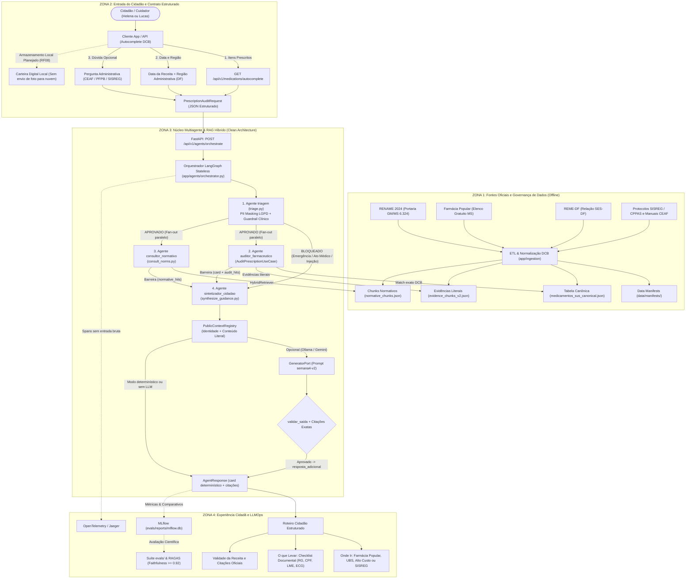

# 🏥 Fluxo de Dados e Arquitetura do Sistema — SUS Cidadão (NavegaSUS)

> **Challenge 2: Qualidade de Vida e Tomada de Decisão com IA**  
> *Instituto Eldorado / UnB / Softex / MCTI*

---

## 1. Visão Geral da Arquitetura (Enterprise Dataflow)

Este documento detalha o fluxo de dados ponta a ponta do projeto **SUS Cidadão**, estruturado no padrão empresarial adotado por Big Techs e healthtechs de missão crítica. 

O sistema é dividido em **4 Zonas Arquiteturais**:
1. **Zona 1 (Governança e Ingestão de Dados Oficiais):** Pipeline offline que normaliza as regras governamentais na Denominação Comum Brasileira (DCB) e gera artefatos JSON versionados (`medicamentos_sus_canonical.json`, `evidence_chunks_v2.json` e `normative_chunks.json`);
2. **Zona 2 (Entrada do Cidadão e Gestão da Receita):** Preenchimento assistido com autocomplete baseado na tabela oficial do SUS, mantendo a eventual digitalização da receita apenas no dispositivo do usuário (arquitetura alvo mobile React Native, RF08);
3. **Zona 3 (Orquestração Multiagente e RAG Híbrido):** Grafo stateless em LangGraph com 4 agentes especializados (`triagem`, `auditor_farmaceutico`, `consultor_normativo` e `sintetizador_cidadao`), consulta determinística tabular e busca em chunks auditados/normativos;
4. **Zona 4 (Entrega Cidadã e LLMOps):** Exibição do roteiro de retirada gratuita e observabilidade via OpenTelemetry/Jaeger, MLflow (`evals/reports/mlflow.db`) e suíte de avaliação (`evals/` + RAGAS).

---

## 2. Diagrama de Fluxo de Dados Ponta a Ponta

---

## 3. Detalhamento das Etapas do Fluxo

### Passo 1: Ingestão de Dados e Linhagem (Zona 1)
- **Origem dos Dados:** RENAME 2024 (Portaria GM/MS nº 6.324/2024), Elenco da Farmácia Popular, REME-DF (SES-DF), Manuais do CEAF e Protocolos SISREG/CPPASS.
- **Data Lineage:** Cada fonte registra metadados e hashes em manifestos dentro de `data/manifests/`.
- **Armazenamento Estruturado em Runtime:**
  - *Tabela Canônica JSON (`medicamentos_sus_canonical.json`):* armazena princípios ativos normalizados pela DCB, concentração, forma farmacêutica, componente e cobertura (PFPB, REME-DF, CEAF, SISREG).
  - *Chunks Auditados e Normativos (`evidence_chunks_v2.json` e `normative_chunks.json`):* armazenam trechos literais com identificador do chunk, fonte oficial e página para busca via `HybridRetriever` e ancoragem estrita de citações.

### Passo 2: Entrada do Cidadão e Gestão da Receita (Zona 2)
- **Decisão Arquitetural de Segurança e Responsabilidade:** Para mitigar riscos de erro na leitura de receitas físicas (evitando troca indevida de medicamentos), a seleção dos itens prescritos usa entrada estruturada com suporte do endpoint `/api/v1/medications/autocomplete` baseado na tabela oficial do SUS.
- **Privacidade por Concepção (LGPD / RF08):** O sistema não trafega imagens de receita nem cria histórico de usuário no backend. O orquestrador recebe requisições 100% stateless e o agente `triagem` aplica mascaramento prévio de PII (`PIIMasker`) antes de acionar qualquer trabalhador.

### Passo 3: Orquestração Multiagente e RAG Híbrido (Zona 3)
- O backend **FastAPI** expõe `POST /api/v1/agents/orchestrate` (além de preservar `POST /api/v1/prescriptions/audit` para clientes diretos da auditoria determinística).
- **1. `triagem`:** Executa desidentificação LGPD (`PIIMasker`) e guardrail clínico/segurança (`ClinicalGuardrail` + `inspecionar_entrada`). Em casos de emergência médica, pedido de conduta clínica (Ato Médico) ou prompt injection, marca `blocked=True` e desvia imediatamente para `sintetizador_cidadao`.
- **2. `auditor_farmaceutico` (paralelo):** Aciona `AuditPrescriptionUseCase.executar_com_evidencias(..., already_triaged=True)` para classificar cada item deterministicamente na tabela canônica e recuperar evidências literais em `evidence_chunks_v2.json`.
- **3. `consultor_normativo` (paralelo):** Executa busca em `normative_chunks.json` via `HybridRetriever` para responder dúvidas administrativas (regionalização CEAF, procuração no Farmácia Popular, requisitos SISREG).
- **4. `sintetizador_cidadao` (barreira única):** Recebe os dois ramos, valida todo o contexto contra `PublicContextRegistry`, preserva o `CitizenGuidanceCard` 100% determinístico e, quando há gerador LLM (`Ollama` ou `Gemini`, com `skip_input_guardrail=True` no contexto já triado), gera explicação complementar em `resposta_adicional` validada por `validar_saida` e acompanhada de citações exatas.

### Passo 4: Entrega ao Cidadão e Observabilidade (Zona 4)
- A resposta estruturada (`AgentResponse`) entrega:
  - **`card` (`CitizenGuidanceCard`):** canal sugerido, checklist documental, alertas de validade e resumo acolhedor determinístico;
  - **`resposta_adicional`, `evidencias` e `citacoes`:** explicação contextual baseada exclusivamente nas fontes oficiais recuperadas;
  - **`agent_trace` e `generation`:** trilha das etapas executadas, latência por nó, versão de prompt (`semana4-v2`) e status científico (`NAO_AVALIADO` até validação RAGAS/humana).
- **LLMOps e Telemetria:** Spans são emitidos via OpenTelemetry para o Jaeger sem exportar entrada bruta do cidadão (`tracing_context(enabled=False)` no LangSmith). Comparativos e avaliações são registrados no MLflow local (`observability/registrar_avaliacoes.py` -> `evals/reports/mlflow.db`) e verificados pelos runners de `evals/` contra os Golden Sets (`Faithfulness` $\ge 0,92$, conforme `ADR 0004`).
