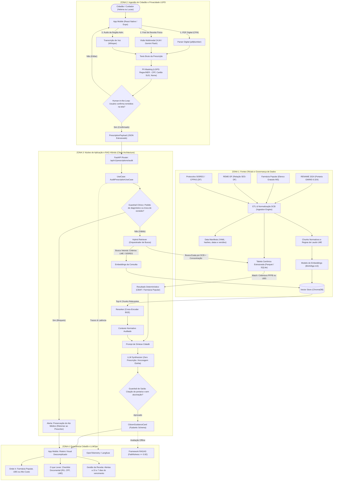

# 🏥 Fluxo de Dados e Arquitetura do Sistema — SUS Cidadão (NavegaSUS)

> **Challenge 2: Qualidade de Vida e Tomada de Decisão com IA**  
> *Instituto Eldorado / UnB / Softex / MCTI*

---

## 1. Visão Geral da Arquitetura (Enterprise Dataflow)

Este documento detalha o fluxo de dados ponta a ponta do projeto **SUS Cidadão**, estruturado no padrão empresarial adotado por Big Techs e healthtechs de missão crítica. 

O sistema é dividido em **4 Zonas Arquiteturais**:
1. **Zona 1 (Governança e Ingestão de Dados Oficiais):** Pipeline offline/batch que normaliza as regras governamentais na Denominação Comum Brasileira (DCB) e alimenta o banco vetorial;
2. **Zona 2 (Ingestão Multimodal e Privacidade LGPD):** Captura pelo app mobile React Native e sanitização de dados sensíveis em memória volátil;
3. **Zona 3 (Núcleo de Decisão e Recuperação Híbrida):** Orquestração dos casos de uso, consulta determinística tabular e busca semântica em portarias;
4. **Zona 4 (Entrega Cidadã e LLMOps):** Exibição do roteiro de retirada gratuita e rastreamento contínuo de latência, fidelidade factual (RAGAS) e custos.

---

## 2. Diagrama de Fluxo de Dados Ponta a Ponta

---

## 3. Detalhamento das Etapas do Fluxo

### Passo 1: Ingestão de Dados e Linhagem (Zona 1)
- **Origem dos Dados:** RENAME 2024 (Portaria GM/MS nº 6.324/2024), Elenco da Farmácia Popular (atualizado em 2026), REME-DF (SES-DF) e Protocolos SISREG/CPPAS.
- **Data Lineage:** Cada documento gera um manifesto YAML em `data/manifests/` contendo data de publicação, hash do arquivo e órgão emissor.
- **Bifurcação de Armazenamento:**
  - *Tabela Canônica (Parquet/SQLite):* Armazena `dcb_principio_ativo`, `concentracao`, `forma_farmaceutica` e flags de gratuidade (PFPB e REME-DF).
  - *Vector Store (ChromaDB):* Armazena chunks semânticos com regras de laudos LME e critérios de agendamento de exames.

### Passo 2: Entrada do Usuário e Anonimização LGPD (Zona 2)
- O cidadão envia a prescrição pelo app **React Native**.
- **PII Masking:** Antes de qualquer processamento por modelos de IA, um pipeline baseado em Regex e NER substitui Nome, CPF e Cartão SUS por tokens anônimos (`[PACIENTE_ANONIMIZADO]`, `[CPF_MASCARADO]`).
- **Human-in-the-Loop (HITL):** A lista de medicamentos identificada é exibida na tela do celular para confirmação do usuário antes de disparar a auditoria no SUS.

### Passo 3: Núcleo de Decisão e RAG Híbrido (Zona 3)
- O backend **FastAPI** recebe a requisição no endpoint `/api/v1/prescriptions/audit` e aciona o caso de uso `AuditPrescriptionUseCase`.
- **Guardrail de Segurança Clínica:** Se a consulta contiver perguntas de automedicação ("posso dobrar a dose?", "qual remédio substitui este?"), o sistema bloqueia imediatamente e orienta o retorno ao médico.
- **Recuperação Híbrida (Hybrid Retrieval):**
  1. *Ramo Determinístico:* Faz match exato por princípio ativo (DCB) na tabela canônica. Se o remédio é Losartana 50mg, o sistema determina imediatamente: *Disponível 100% gratuito na Farmácia Popular (drogaria privada com CPF) e na UBS*.
  2. *Ramo Semântico:* Para remédios que exigem processo de Alto Custo (ex.: Dapagliflozina 10mg) ou exames (Ecocardiograma), busca nos chunks vetoriais os critérios clínicos e documentos exigidos.
- **Síntese Cidadã:** A LLM atua exclusivamente como redatora empática e acessível, traduzindo termos técnicos sem criar novas regras.

### Passo 4: Entrega ao Cidadão e Observabilidade (Zona 4)
- O app exibe o **Roteiro Cidadão**:
  - **Onde ir:** Mapa da drogaria credenciada mais próxima ou UBS;
  - **O que levar:** Documento com foto, CPF, receita válida e formulário LME preenchido (se aplicável);
  - **Validade da receita:** Contagem regressiva com notificações push locais a 15 e 7 dias do vencimento.
- **LLMOps e Telemetria:** Toda requisição gera traces de latência e consumo de tokens via OpenTelemetry, e as respostas são avaliadas periodicamente contra o *Golden Dataset* com o framework **RAGAS** (meta de *Faithfulness* $\ge 0,92$).
