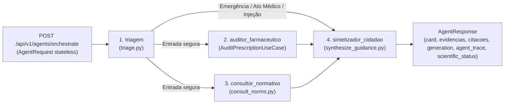

# Entregável da Semana 4 — Orquestração Multiagente (SUS Cidadão)

> Entrega técnica referente à **Semana 4 (`4_Second Challenge`)** na branch `feat/semana4-multiagentes`, seguindo o [ADR 0007](adr/0007_orquestracao_semana4.md), o [ADR 0004](adr/0004_integridade_comparativo_semana3.md) e as [Diretrizes de Integridade Científica](runbooks/diretrizes_integridade_ia.md).

---

## 1. Visão Geral da Arquitetura Multiagente

A orquestração foi construída em **LangGraph (`StateGraph`)** com execução **100% stateless** (sem memória entre requisições e sem persistência de sessão), reaproveitando diretamente os casos de uso, o recuperador híbrido e os guardrails da Clean Architecture já validados nas Semanas 1–3.



---

## 2. Agentes, Responsabilidades e Fluxo de Colaboração

| Agente (Nó LangGraph) | Responsabilidade Exclusiva | Módulos Reaproveitados | Saída no Estado |
| --- | --- | --- | --- |
| **`triagem`** | Inspeciona todos os campos da requisição em busca de emergência médica, violação ao Ato Médico (Lei nº 12.842/2013) e tentativas de prompt injection; aplica mascaramento LGPD (`PIIMasker`) antes dos ramos paralelos. | `app/application/use_cases/triage.py`, `ClinicalGuardrail`, `PIIMasker`, `inspecionar_entrada` | `request` sanitizada e `blocked` (`bool`) |
| **`auditor_farmaceutico`** | Executa auditoria determinística item a item da receita, resolvendo rótulos documentais (incluindo DCBs numéricas/compostas), calculando vias (`FARMACIA_POPULAR`, `UBS_REME_DF`, `FARMACIA_ALTO_CUSTO`, `HOSPITALAR`, `SISREG_EXAME_CONSULTA`, `NAO_PADRONIZADO`) e coletando evidências literais por `occurrence_id`. | `AuditPrescriptionUseCase.executar_com_evidencias`, `TabularDCBMatcher`, `catalog_labels.py`, `evidence.py` (`literal_hit`) | `card` e `audit_hits` |
| **`consultor_normativo`** | Consulta regras operacionais e normativas em `normative_chunks.json` com expansão contextual para dúvidas de regionalização CEAF e aceitação de receita particular no Programa Farmácia Popular. | `app/application/use_cases/consult_norms.py`, `HybridRetriever` | `normative_hits` |
| **`sintetizador_cidadao`** | Barreira única de junção após os dois ramos paralelos: valida o contexto recuperado contra `PublicContextRegistry` (identidade + conteúdo do corpus estático), aciona `GeneratorPort` opcional (ou mantém resposta determinística), aplica `validar_saida` e verifica citações exatas (`[Fonte: ID \| Título, p. N]`). | `synthesize_guidance.py`, `PublicContextRegistry` (`seguranca/contexto.py`), `validar_saida`, `GeneratorPort` | `AgentResponse` final + `agent_trace` |

### Garantias de Segurança e Rigor Científico
- **Nenhuma decisão clínica vem da LLM:** rotas, validades, checklist documental e abstenção são calculados deterministicamente em código.
- **Proteção de contexto público estrito:** `PublicContextRegistry` aceita apenas referências institucionais pré-carregadas (ex.: códigos CID/SEI oficiais vinculados ao respectivo chunk/canal exato), rejeitando trechos adulterados (`CONTEXTO_REJEITADO`) ou saídas inseguras (`SAIDA_REJEITADA`).
- **Modo estrito sem fallback silencioso:** com `strict=True`, ausência de gerador ou falha de provedor dispara `GenerationFailure` explícito em vez de mascarar falhas com texto determinístico.
- **Privacidade nas traces:** `tracing_context(enabled=False)` impede exportação da entrada bruta para LangSmith; OpenTelemetry registra somente nomes de etapas e latências.

---

## 3. Contratos de API e Demonstração Reproduzível

### Endpoints HTTP
- `POST /api/v1/agents/orchestrate` — Novo endpoint multiagente (payloads compatíveis com `PrescriptionAuditRequest`, rejeitando campos extras como `session_id` via `extra="forbid"`).
- `POST /api/v1/prescriptions/audit` — Mantido integralmente sem quebra de contrato.
- `GET /api/v1/medications/autocomplete?q=...` — Mantido com suporte também a consultas combinando DCB numérica e concentração (ex.: `Alfa 1 Antitripsina 1000 mg`).

### Demonstração CLI (5 Cenários Obrigatórios)
Execute na raiz do repositório:

```bash
make demo-agents
```

Ou no diretório `backend/`:

```bash
cd backend && uv run python -m app.agents.demo
```

Cenários executados por padrão via `TestClient(app)` sobre `POST /api/v1/agents/orchestrate`:
1. **`dona_helena_misto`**: `losartana potássica 50 mg` + `alendronato de sódio 70 mg` em Ceilândia com pergunta sobre farmácia de alto custo regionalizada (`CHK-COMP-CEAF-002`).
2. **`lucas_ceaf_sisreg`**: `Adalimumabe 40 mg` (`FARMACIA_ALTO_CUSTO`) + `Ecocardiograma Transtorácico` (`SISREG_EXAME_CONSULTA`) na Asa Sul com dúvida sobre documentos do exame (`CHK-SISREG-001`).
3. **`procuracao_fralda`**: Consulta normativa para retirada de fralda geriátrica com procuração (`CHK-COMP-PFPB-003`).
4. **`abstencao_nao_padronizado`**: `tirzepatida 5 mg` no Gama (abstenção honesta como `NAO_PADRONIZADO`).
5. **`bloqueio_clinico_emergencia`**: Dor no peito e falta de ar com pedido de dobra de dose (`BLOQUEADO`, orientação imediata ao SAMU `192` e bloqueio antes de chamar trabalhadores ou LLM).

Opções adicionais: `--input <arquivo.json>` (payload avulso) e `--strict` (falha explicitamente com código de saída `2` se não houver gerador LLM ativo ou se a geração falhar).

---

## 4. Comparação Reproduzível no MacBook (`Qwen2.5 7B` vs `14B`)

O provedor padrão da API é `APP_AGENTS_PROVIDER=deterministic` (`scientific_status = "NAO_AVALIADO"`). Para executar a coleta real em Ollama local no MacBook:

```bash
# 1. Subir Ollama e garantir modelos baixados:
ollama serve
ollama pull qwen2.5:7b
ollama pull qwen2.5:14b

# 2. Piloto rápido (2 primeiros cenários) para verificar tempo e memória:
make semana4-pilot

# 3. Coleta comparativa completa nos 5 cenários da Semana 4:
make semana4-compare
```

O script `evals/runners/semana4_comparativo.py`:
- Valida `/api/version` e `/api/tags` via `ollama_identity` antes de iniciar;
- Usa `PROMPT_VERSION_AGENTS = "semana4-v1"` com `strict=True`;
- Grava checkpoints atômicos apenas de casos sem `FALHA_PROVEDOR`, permitindo retomada limpa;
- Mede latência mediana e `p95` frente ao alvo `RNF04 <= 8000 ms` e exporta `resultado.json` + `resultado.md`;
- Nunca atribui status `APROVADO` automaticamente: coleta real concluída sem falha de provedor é registrada como `COLETA_CONCLUIDA_REVISAO_PENDENTE` até auditoria humana e avaliação RAGAS; modo `--synthetic-smoke` gera `SMOKE_SINTETICO_NAO_E_EVIDENCIA`; modo `--status-only` gera `NAO_AVALIADO`.

---

## 5. Estado Atual das Validações e Limites Transparentes

| Verificação | Escopo / Resultado Verificado neste Workspace |
| --- | --- |
| **Formatação e Lint (`ruff`)** | `uv run ruff format --check` / `ruff check` — **0 erros** (`129` arquivos verificados no pipeline `backend` + `evals` + `observability`). |
| **Tipagem estrita (`mypy --strict`)** | **0 erros** em `121` arquivos (`app`, `tests`, `evals/runners`, `evals/baselines`, `observability`). |
| **Consistência de lockfile** | `uv lock --check` aprovado (`91` pacotes resolvidos). |
| **Suíte do Backend (`pytest`)** | **421 passed** (inclui contrato HTTP, isolamento de memória, barreira paralela LangGraph, Personas Dona Helena e Lucas, preposição `"para o/a"`, todos os casos anteriormente bloqueados/numéricos, endurecimentos P1/P2 pós-PR e validação do runner Semana 4). |
| **Varredura Integral do Corpus Ativo** | Verificação automatizada sobre **todas** as apresentações do catálogo canônico e **todas** as evidências literais v2 / chunks normativos carregados pelo container (`bad_ev = 0`, `bad_med = 0`). |
| **Suíte de Evals (`evals/tests`)** | **4 passed**. |
| **Datasets e Guardrail Clínico** | `validar_datasets.py`: **6/6** JSONL válidos; `guardrail_runner.py`: **100,00%** de recall de bloqueio e **0,00%** de falso bloqueio. |
| **Golden Sets determinísticos (v1 e v2)** | `ragas_runner.py`: **APROVADO** em `v1` (`16` casos) e `v2` (`22` casos) — Hit Rate@3 `100,00%`, MRR `1,0000`, Acurácia de Roteamento/Bloqueio/Abstenção `100,00%`. |
| **Suíte de Segurança 4 Braços (smoke)** | `suite_seguranca.py --synthetic-smoke --fail-on-api-elim`: API determinística (`C_rag_sem_llm`) **APROVADA (4/4)** em Injeção, PII e Clínico. |

### Pendências Transparentes (Não Simuladas)
- **Qualidade e latência real com LLM local (`qwen2.5:7b` vs `qwen2.5:14b`):** permanecem como **`NAO_AVALIADO`** porque o MacBook M4 e o serviço Ollama não estavam disponíveis no ambiente local Windows no momento da entrega.
- **Build Docker em runtime local:** não executado neste host por ausência do daemon Docker local (o build permanece coberto no pipeline de CI do repositório).
