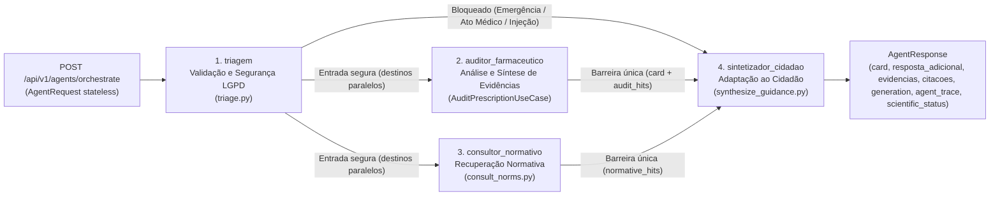

# Entregável da Semana 4 — Orquestração Multiagente (SUS Cidadão)

> Entrega técnica referente à **Semana 4 (`4_Second Challenge`)** na branch `main`, seguindo o [ADR 0007](adr/0007_orquestracao_semana4.md), o [ADR 0004](adr/0004_integridade_comparativo_semana3.md) e as [Diretrizes de Integridade Científica](runbooks/diretrizes_integridade_ia.md).
> **Destino de submissão (`4_Second Challenge`):** artefato consolidado para documentação da arquitetura multiagente, descrição de responsabilidades, fluxo de colaboração e evidências de demonstração.

---

## 1. Visão Geral da Arquitetura Multiagente

A orquestração foi construída em **LangGraph (`StateGraph`)** (`backend/app/agents/orchestrator.py`) com execução **100% stateless** (sem memória entre requisições e sem persistência de sessão), reaproveitando diretamente os casos de uso, o recuperador híbrido e os guardrails da Clean Architecture já validados nas Semanas 1–3.



---

## 2. Agentes, Responsabilidades e Fluxo de Colaboração

### Mapeamento de Papéis e Contratos Internos

| Agente (Nó LangGraph) | Papel Multiagente | Responsabilidade Exclusiva | Módulos Reaproveitados | Saída no Estado |
| --- | --- | --- | --- | --- |
| **`triagem`** | Validação de entrada e identificação de inconsistências de segurança | Inspeciona todos os campos da requisição em busca de emergência médica, violação ao Ato Médico (Lei nº 12.842/2013) e prompt injection; aplica mascaramento LGPD (`PIIMasker`) antes dos ramos paralelos. | `app/application/use_cases/triage.py`, `ClinicalGuardrail`, `PIIMasker`, `inspecionar_entrada` | `request` sanitizada e `blocked` (`bool`) |
| **`auditor_farmaceutico`** | Análise determinística e síntese de evidências medicamentosas | Executa auditoria determinística item a item contra o catálogo canônico, calculando rotas (`FARMACIA_POPULAR`, `UBS_REME_DF`, `FARMACIA_ALTO_CUSTO`, `HOSPITALAR`, `SISREG_EXAME_CONSULTA`, `NAO_PADRONIZADO`) e coletando evidências literais em `evidence_chunks_v2.json`. Recebe `already_triaged=True` do orquestrador para evitar checagens e logs duplicados. | `AuditPrescriptionUseCase.executar_com_evidencias`, `TabularDCBMatcher`, `catalog_labels.py`, `evidence.py` | `card` e `audit_hits` |
| **`consultor_normativo`** | Recuperação de informações normativas e regulatórias | Consulta regras operacionais e protocolos em `normative_chunks.json` com expansão contextual para dúvidas de regionalização CEAF, procuração/receita no Farmácia Popular e regulação SISREG/CPPASS. | `app/application/use_cases/consult_norms.py`, `HybridRetriever` | `normative_hits` |
| **`sintetizador_cidadao`** | Validação final de evidências e adaptação da comunicação ao cidadão | Barreira única de junção após os dois ramos paralelos: valida contexto via `PublicContextRegistry`, foca o contexto da LLM em `normative_hits` quando há `pergunta_adicional`, mantém `card` 100% determinístico, gera explicação opcional em `resposta_adicional` via `GeneratorPort` (`skip_input_guardrail=True` para contexto já triado), aplica `validar_saida` e verifica citações exatas (`[Fonte: ID \| Título, p. N]`). | `synthesize_guidance.py`, `PublicContextRegistry` (`seguranca/contexto.py`), `validar_saida`, `GeneratorPort` | `AgentResponse` final + `agent_trace` |

### Fluxo Passo a Passo de Interação e Colaboração

1. **Entrada e Triagem (`triagem`):** `POST /api/v1/agents/orchestrate` cria o estado inicial e aciona `triagem`. Se houver emergência clínica, pedido de conduta médica ou prompt injection, `blocked=True` dispara curto-circuito direto para `sintetizador_cidadao`, impedindo chamadas desnecessárias aos trabalhadores ou à LLM.
2. **Colaboração em Paralelo (destinos condicionais -> `auditor_farmaceutico` + `consultor_normativo`):** Com a entrada aprovada e já desidentificada (PII mascarado), o grafo dispara os dois agentes em paralelo por destinos condicionais em lista:
   - `auditor_farmaceutico` resolve cada item prescrito deterministicamente e anexa evidências literais por `occurrence_id` (`audit_hits`), preservando `already_triaged=True` no grafo (enquanto `/api/v1/prescriptions/audit` mantém inspeção defensiva própria).
   - `consultor_normativo` recupera trechos normativos (`normative_hits`) relevantes à `pergunta_adicional` e à região administrativa.
3. **Barreira de Junção e Síntese (`sintetizador_cidadao`):** O nó sintetizador só executa após a conclusão dos dois ramos paralelos:
   - Valida a integridade literal e de identidade de cada chunk no `PublicContextRegistry`;
   - Mantém o `CitizenGuidanceCard` (`card`) e todas as rotas/documentos 100% determinísticos;
   - Quando há gerador ativo e `pergunta_adicional`, envia contexto focado em `normative_hits` à LLM com prompt `semana4-v2`, gravando a explicação validada em `resposta_adicional` sem alterar `card.resumo_acolhedor`;
   - Anexa `agent_trace` com a sequência e duração em ms de cada agente executado e propaga `generation.prompt_version`.

### Garantias de Segurança e Rigor Científico
- **Nenhuma decisão clínica vem da LLM:** rotas, validades, checklist documental e abstenção são calculados deterministicamente em código.
- **Proteção de contexto público estrito:** `PublicContextRegistry` aceita apenas referências institucionais pré-carregadas (ex.: códigos CID/SEI oficiais vinculados ao respectivo chunk/canal exato), rejeitando trechos adulterados (`CONTEXTO_REJEITADO`) ou saídas inseguras (`SAIDA_REJEITADA`).
- **Modo estrito sem fallback silencioso:** com `strict=True`, ausência de gerador ou falha de provedor dispara `GenerationFailure` explícito em vez de mascarar falhas com texto determinístico.
- **Privacidade nas traces:** `tracing_context(enabled=False)` impede exportação da entrada bruta para LangSmith; OpenTelemetry registra somente nomes de etapas e latências.

---

## 3. Contratos de API, Demonstração Reproduzível e Observabilidade

### Endpoints HTTP
- `POST /api/v1/agents/orchestrate` — Endpoint multiagente (payloads compatíveis com `PrescriptionAuditRequest`, rejeitando campos extras como `session_id` via `extra="forbid"`).
- `POST /api/v1/prescriptions/audit` — Mantido integralmente sem quebra de contrato.
- `GET /api/v1/medications/autocomplete?q=...` — Mantido com suporte também a consultas combinando DCB numérica e concentração (ex.: `Alfa 1 Antitripsina 1000 mg`).

### Demonstração CLI (5 Cenários Obrigatórios)
Execute na raiz do repositório ou em `backend/` (o modo padrão é determinístico; com `APP_AGENTS_PROVIDER=ollama`, aciona o modelo local):

```bash
make demo-agents
# ou para saída resumida legível com gerador LLM estrito:
cd backend && APP_AGENTS_PROVIDER=ollama APP_AGENTS_MODEL=qwen2.5:7b APP_AGENTS_TIMEOUT_SECONDS=60 uv run python -m app.agents.demo --strict --summary
```

Cenários executados pela CLI (`app.agents.demo`):
1. **`dona_helena_misto`**: `losartana potássica 50 mg` + `alendronato de sódio 70 mg` em Ceilândia com pergunta sobre farmácia de alto custo regionalizada (`CHK-COMP-CEAF-002`, `CHK-REGRA-CEAF-001`, `CHK-COMP-INFOSAUDE-001`).
2. **`lucas_ceaf_sisreg`**: `Adalimumabe 40 mg` (`FARMACIA_ALTO_CUSTO`) + `Ecocardiograma Transtorácico` (`SISREG_EXAME_CONSULTA`) na Asa Sul com dúvida sobre documentos do exame (`CHK-SISREG-001`).
3. **`procuracao_fralda`**: Consulta normativa em Ceilândia para retirada de fralda geriátrica com procuração (`CHK-COMP-PFPB-003`, `CHK-REGRA-PFPB-001`).
4. **`abstencao_nao_padronizado`**: `tirzepatida 5 mg` no Gama (abstenção honesta como `NAO_PADRONIZADO`, determinístico).
5. **`bloqueio_clinico_emergencia`**: Dor no peito e falta de ar com pedido de dobra de dose (`BLOQUEADO`, orientação imediata ao SAMU `192` e desvio direto de `triagem` para `sintetizador_cidadao`).

Opções da CLI: `--input <arquivo.json>` (payload avulso), `--strict` (código de saída `2` sem gerador LLM ativo ou em falha) e `--summary` (exibe rota, fluxo dos 4 agentes com tempos, cartão determinístico, resposta e citações).

### Observabilidade Unificada (MLflow)
As execuções experimentais são indexadas em `evals/reports/mlflow.db` via `observability/registrar_avaliacoes.py` (`make registrar-avaliacoes` e `make mlflow-ui`), com backfill automático quando artefatos `run_*.json` existem sem registro correspondente no SQLite do MLflow.

---

## 4. Comparação Empírica no MacBook (`Qwen2.5 7B` vs `14B` — `semana4-v2`)

O provedor padrão da API é `APP_AGENTS_PROVIDER=deterministic` (`APP_AGENTS_TIMEOUT_SECONDS=60`, `scientific_status = "NAO_AVALIADO"`). Para executar a coleta comparativa real em Ollama local no MacBook:

```bash
ollama serve
ollama pull qwen2.5:7b
ollama pull qwen2.5:14b
make semana4-pilot     # 2 primeiros cenários
make semana4-compare   # 5 cenários completos (timeout padrão 120s)
make semana4-eval      # Avaliação automatizada (controles + Juiz LLM + RAGAS 0.4.3)
```

O script `evals/runners/semana4_comparativo.py`:
- Valida `/api/version` e `/api/tags` via `ollama_identity` antes de iniciar;
- Usa `PROMPT_VERSION_AGENTS = "semana4-v2"` com `strict=True` e `skip_input_guardrail=True`;
- Grava checkpoints atômicos de casos sem `FALHA_PROVEDOR`, permitindo retomada limpa;
- Mede latência mediana e `p95` frente ao alvo `RNF04 <= 8000 ms` e exporta `resultado.json` + `resultado.md`;
- Registra status `COLETA_CONCLUIDA_REVISAO_PENDENTE` até avaliação RAGAS/auditoria factual (nunca promove `APROVADO` automaticamente).

### Resultados Coletados em `evals/reports/semana4_comparativo_v2/resultado.json`

| Modelo Ollama | Status da Coleta | Casos (`Exec/Plan`) | Gerados / Abstenções / Bloqueios | Falhas / Rejeições | Mediana Wall (ms) | `p95` Wall (ms) | Mediana Geração (ms) | Meta `RNF04 <= 8000 ms` |
| --- | --- | --- | --- | --- | --- | --- | --- | --- |
| **`qwen2.5:7b`** | `COLETA_CONCLUIDA_REVISAO_PENDENTE` | `5/5` | `3 / 1 / 1` | `0` | `6705,25` | `17867,63` | `6687,43` | `false` (`p95 > 8 s` na rodada medida) |
| **`qwen2.5:14b`** | `COLETA_CONCLUIDA_REVISAO_PENDENTE` | `5/5` | `3 / 1 / 1` | `0` | `13132,39` | `37282,84` | `13099,48` | `false` (`mediana` e `p95 > 8 s`) |

### Avaliação Automatizada (`evals/runners/semana4_avaliacao.py`)

O runner `semana4_avaliacao.py` (`make semana4-eval`, indexado no MLflow via `--semana4-avaliacao`) avalia automaticamente os relatórios reais da Semana 4 sem mascarar a ausência de revisão humana:
- **Camada Determinística (`0–10`):** confere rota esperada, status de geração, trilha exata de agentes, existência dos chunks citados, isolamento de LLM em abstenção/bloqueio e `validar_saida`.
- **Juiz Estruturado PT-BR (`0–10`):** confronta `response_text` estritamente contra os textos reais de `normative_chunks.json` / `evidence_chunks_v2.json` via schema Pydantic (`fidelidade`, `completude`, `clareza_relevancia`, `seguranca_postura`, contradições e omissões), com travas programáticas caso aponte contradição (`<= 4,0`), item não verificável (`<= 7,5`) ou omissões.
- **RAGAS Oficial (`0.4.3`, PT-BR + `bge-m3`):** mede `Faithfulness` (meta `>= 0,92`) e `Answer Relevancy` (meta `>= 0,88`) diretamente sobre o texto gerado e os chunks recuperados.

Medição executada com `evaluator_model = "semana3-qwen14"` e `embedding_model = "bge-m3"` (`evals/reports/semana4_avaliacao_v2/avaliacao_automatica.json`):

| Modelo | Status | Nota Geral (0–10) | Determ. | Juiz LLM | RAGAS Faith. (meta >= 0,92) | RAGAS Rel. (meta >= 0,88) | Contradições | Omissões (casos) |
| --- | --- | ---: | ---: | ---: | --- | --- | ---: | ---: |
| **`qwen2.5:7b`** | `REPROVADO_OU_COM_RESSALVAS` | `8,25` | `10,00` | `7,50` | `0,8095` (`REPROVADO`) | `0,8824` (`APROVADO`) | `0` | `3` |
| **`qwen2.5:14b`** | `REPROVADO_OU_COM_RESSALVAS` | `8,25` | `10,00` | `7,50` | `1,0000` (`APROVADO`) | `0,8229` (`REPROVADO`) | `0` | `3` |

Observações técnicas observadas nos artefatos `semana4-v2`:
- A evolução de `semana4-v1` para `semana4-v2` (contexto focado em `normative_hits` quando há `pergunta_adicional` + instrução explícita para listar documentos e requisitos presentes nos trechos) eliminou a abstenção indevida que ocorria em `lucas_ceaf_sisreg` no `qwen2.5:7b` e zerou falhas/rejeições em ambos os modelos.
- Em `procuracao_fralda`, `qwen2.5:14b` entregou a resposta mais completa (incluindo o laudo médico de incontinência junto da procuração e dos documentos com CPF) e atingiu `Faithfulness = 1,0000` no RAGAS, enquanto `qwen2.5:7b` omitiu o laudo médico nessa resposta e caiu para `0,4286` de `Faithfulness` em `lucas_ceaf_sisreg`.
- Limitação honesta do juiz local (`semana3-qwen14` Q4): embora tenha acertado omisses reais no `7b` (ex.: laudo médico em `procuracao_fralda` e InfoSaúde em `dona_helena_misto`), o juiz estruturado local também gerou falsos positivos em `afirmacoes_nao_verificaveis` e em omissões no `14b` (listando `ECG` ou `laudo` como ausentes mesmo presentes no texto), acionando o teto conservador de `7,50/10` — motivo pelo qual revisão externa/humana independente continua recomendada antes de certificar qualidade clínica final.
- Os três agentes determinísticos (`triagem` + `auditor_farmaceutico` + `consultor_normativo`) executam em dezenas de milissegundos; o gargalo atual de latência (`RNF04`) está concentrado no cold-start e no tempo de geração local da LLM no `sintetizador_cidadao`.

---

## 5. Estado Atual das Validações e Limites Transparentes

| Verificação | Escopo / Resultado Verificado |
| --- | --- |
| **Formatação e Lint (`ruff`)** | `uv run ruff format --check . ../evals ../observability` e `uv run ruff check . ../evals ../observability` — **0 erros** (`133` arquivos verificados). |
| **Tipagem estrita (`mypy --strict`)** | **0 erros** em `125` arquivos (`app`, `tests`, `evals/runners`, `evals/baselines`, `observability`). |
| **Consistência de lockfile** | `uv lock --check` aprovado no container Linux da imagem final (91 pacotes). |
| **Suíte do Backend (`pytest`)** | **447 passed** (contrato HTTP multiagente e legado, isolamento stateless, barreira paralela LangGraph, Personas Dona Helena e Lucas, contexto focado em `normative_hits`, preservação do cartão determinístico, `--summary`, avaliação automatizada `semana4_avaliacao`, backfill MLflow e validações do runner Semana 4). |
| **Suíte de Evals (`make eval-test`)** | **4 passed**. |
| **Datasets e Guardrail Clínico (`make eval`)** | `validar_datasets.py` e `guardrail_runner.py` aprovados em todos os arquivos do diretório `evals/datasets/`. |
| **Golden Sets determinísticos (`make benchmark`)** | `ragas_runner.py`: **APROVADO** em `v1` (`16` casos) e `v2` (`22` casos) — Hit Rate@3 `100,00%`, MRR `1,0000`, acurácia de roteamento/bloqueio/abstenção `100,00%`. |
| **Suíte de Segurança 4 Braços (`make seguranca-smoke`)** | `suite_seguranca.py --synthetic-smoke --fail-on-api-elim`: API determinística (`C_rag_sem_llm`) **APROVADA (`4/4`)**. |
| **Smoke HTTP em servidor real (`uvicorn`)** | `backend/tests/smoke_http.py` aprovado contra instância real FastAPI (`GET /health`, autocomplete e fluxo de auditoria/orquestração). |

### Pendências Transparentes (Não Mascaradas)
- **Revisão factual humana independente das respostas de `semana4-v2`:** permanece como `revisao_humana_realizada = false` (não substituída pela avaliação automatizada via `semana4_avaliacao.py`).
- **Aprovação integral simultânea nos gates RAGAS e de latência `RNF04` (`p95 <= 8 s`) com LLM local:** `qwen2.5:7b` atingiu `Answer Relevancy` (`0,8824 >= 0,88`), mas reprovou em `Faithfulness` (`0,8095 < 0,92`); `qwen2.5:14b` atingiu `Faithfulness` (`1,0000 >= 0,92`), mas reprovou em `Answer Relevancy` (`0,8229 < 0,88`); ambos excederam `RNF04 <= 8 s` no `p95` (`17,87 s` e `37,28 s`).
- **Build Docker em runtime local:** build e smoke HTTP executados após a revisão de 19/11; CI remoto ainda depende do PR.


## Correções após a revisão independente de 19/11

O avaliador vigente usa rubrica `semana4-eval-v2`. As tabelas da seção 4 representam o registro histórico da rodada `v2`/rubrica `v1`, preservado com manifestos em
[docs/reviews/evidencias_semana4_2026_11_19](reviews/evidencias_semana4_2026_11_19/) (sem alteração de escores antigos).

Uma nova rodada completa foi executada com o código e rubrica `semana4-eval-v2` (`evals/reports/semana4_comparativo_v3/resultado.json` e `avaliacao/avaliacao_automatica.json`, indexada no MLflow sob `semana4-v3-2026-11-19`):
- **`qwen2.5:7b` (`5/5` casos, `0` falhas):** Determ. `10,00/10`, Juiz `7,50/10` (`completude 6,67`), RAGAS Faithfulness `0,8095` (`REPROVADO`), Answer Relevancy `0,8824` (`APROVADO`), mediana `6650,78 ms`, `p95 = 19077,00 ms` (`RNF04 = false`).
- **`qwen2.5:14b` (`5/5` casos, `0` falhas):** Determ. `10,00/10`, Juiz `7,50/10` (`completude 7,33`), RAGAS Faithfulness `1,0000` (`APROVADO`), Answer Relevancy `0,8229` (`REPROVADO`), mediana `10999,81 ms`, `p95 = 33861,30 ms` (`RNF04 = false`).
- Código de saída `2` (conforme esperado pelo `ADR 0004` diante de metas parciais/latência); limitação do juiz local (`semana3-qwen14`, mesma família dos modelos avaliados) e ausência de revisão humana clínica permanecem transparentes.

Para reproduzir em diretório limpo:

```bash
make semana4-compare S4_RUN_DIR=evals/reports/semana4_comparativo_v3
make semana4-eval S4_RUN_DIR=evals/reports/semana4_comparativo_v3
```

A avaliação grava em `<S4_RUN_DIR>/avaliacao` e exige os cinco cenários sem
IDs repetidos/desconhecidos. Gates RAGAS ausentes não aprovam; qualidade automática
e latência são separadas. Códigos de saída: 1 incompleto, 2 reprovado (incluindo
latência), 3 gates automáticos satisfeitos mas revisão humana pendente. Código 0
é reservado ao smoke sintético explícito, sem valor de evidência científica.
Não alterar manifestos históricos para permitir retomada com código diferente.

O MLflow reconcilia JSON e registro nativo em ambas as direções. Na importação,
o manifesto atual é rotulado `ambiente_importacao_*`; não é atribuído ao experimento
antigo. Quando a linhagem não vem no artefato, fica explicitamente não informada.
Falha de consulta ao MLflow adia escrita nativa e mantém recuperação pelo JSON.
O holdout aplica `--max-falso-bloqueio 0.05` nas três camadas; seus casos devem
continuar sendo escritos e congelados por pessoa independente.
