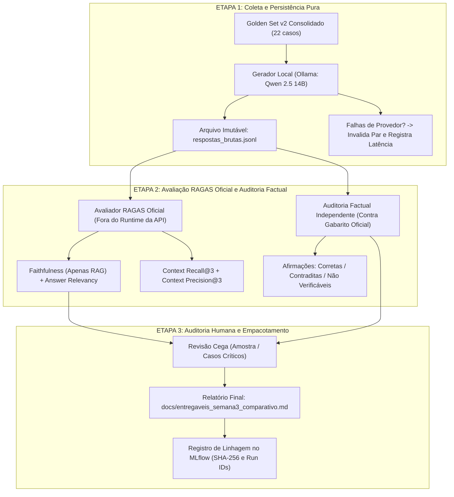

# Plano de Execução da Semana 3 — LLM Local (MacBook Air M4 24GB)

- **Status:** Proposto e pronto para execução presencial na quinta-feira.
- **Hardware-Alvo:** Apple MacBook Air M4 (2025), 13 polegadas, 24 GB de Memória Unificada, 494 GB SSD, aceleração Metal via macOS.
- **Branch:** `feat/semana3-comparativo-llm-vs-rag` (sem merge na `main` até a conclusão empírica).
- **Normas Vinculantes:** [ADR 0003](../adr/0003_estrategia_avaliacao_metricas_ragas.md), [ADR 0004](../adr/0004_integridade_comparativo_semana3.md) e [Diretrizes de Integridade](../runbooks/diretrizes_integridade_ia.md).

---

## 1. Escolha de Modelos e Alocação de Memória no M4 (24 GB)

Com 24 GB de memória unificada compartilhada entre CPU e GPU Metal, o hardware suporta com folga modelos entre 7B e 14B quantizados em 4 ou 8 bits.

### Modelo Selecionado: `qwen2.5:14b-instruct-q4_K_M` (ou alternativamente `llama3.1:8b-instruct-q8_0`)

| Papel | Modelo Escolhido | Quantização | VRAM / Memória Alocada | Taxa Esperada (M4 Metal) | Motivo da Escolha |
| :--- | :--- | :--- | :--- | :--- | :--- |
| **Gerador Pareado (Braços 1 e 2)** | `qwen2.5:14b` | `Q4_K_M` | ~9.2 GB | ~32 a 40 tokens/s | Estado da arte na faixa 14B para língua portuguesa, rigoroso em aderência a contexto, sem censuras espúrias em dados de saúde pública e excelente em evitar alucinações de formato. |
| **Avaliador RAGAS / Juiz Factual** | `qwen2.5:14b` *(em etapa desacoplada)* | `Q4_K_M` | ~9.2 GB | ~32 a 40 tokens/s | Como a coleta e a avaliação ocorrem em fases separadas, o mesmo modelo pode avaliar as afirmações atômicas sem concorrência de memória. |
| **Alternativa Leve (Máxima Velocidade)** | `llama3.1:8b` | `Q8_0` | ~8.5 GB | ~55 a 65 tokens/s | Excelente raciocínio e velocidade extrema se houver restrição de tempo no laboratório. |

*Memória livre restante no macOS durante a execução: > 14 GB.*

---

## 2. Desenho do Experimento e Separação em Duas Etapas

Seguindo as determinações do ADR 0004, o processo é estritamente **desacoplado em duas etapas independentes**:



---

## 3. As Quatro Etapas de Execução (Passo a Passo)

### Etapa 1: Preparação do Ambiente no Mac (Quinta-Feira)

Instalação do Ollama nativo para macOS e download do modelo:

```bash
# 1. Instalar Ollama no macOS (caso não esteja instalado)
brew install ollama
# ou baixar diretamente do site oficial: https://ollama.com/download/mac

# 2. Iniciar o serviço Ollama em background
ollama serve &

# 3. Baixar o modelo gerador/avaliador e o modelo de embeddings exigido pelo RAGAS
ollama pull qwen2.5:14b
ollama pull bge-m3

# 4. Sincronizar os ambientes isolados do backend e do RAGAS (evals/)
make dev-install
make eval-setup

# 5. Fazer chamada de verificação de sanidade (smoke check de 1 segundo)
curl -s http://localhost:11434/api/generate -d '{
  "model": "qwen2.5:14b",
  "prompt": "Responda apenas: pronto",
  "stream": false
}' | jq .response
```

---

### Etapa 2: Coleta Pareada de Respostas (`evals/runners/comparar_semana3.py`)

Execução dos 22 casos do Golden Set congelado (`golden_set_v2_consolidado.jsonl`):

- **Braço 1 (`llm_sem_recuperacao`)**: Pergunta sem contexto, `temperature=0.0`, limite de 450 tokens.
- **Braço 2 (`llm_com_rag`)**: Mesma pergunta, Top-3 chunks do `HybridRetriever`, `temperature=0.0`.
- **Persistência**: Gravação em pasta única `evals/reports/coleta_real_semana3_<id>/` com `resultado.json`, `respostas_brutas.jsonl` e `resultado.md`.
- **Regra**: Falhas de timeout ou erro de servidor invalidam o par e registram `error_code`. Controles determinísticos (bloqueio clínico e abstenção segura) são identificados como `CONTROLE_DETERMINISTICO`, isolados das respostas de modelo puro (`PAR_LLM`).

Comando:
```bash
uv run --project backend python evals/runners/comparar_semana3.py \
  --provider ollama \
  --model qwen2.5:14b \
  --dataset evals/datasets/golden_set_v2_consolidado.jsonl
# Ou via Makefile:
# make compare-ollama MODEL=qwen2.5:14b DATASET=evals/datasets/golden_set_v2_consolidado.jsonl
```

*(Nota: o código de saída esperado ao final da coleta pura é `2`, pois a certificação RAGAS ocorre na Etapa 3.)*

---

### Etapa 3: Avaliação RAGAS Oficial (`ragas==0.4.3`) e Auditoria Factual (`evals/runners/avaliar_ragas_oficial.py`)

Conforme o ADR 0003 e ADR 0004, o framework RAGAS oficial (`ragas==0.4.3`, isolado em `evals/pyproject.toml` e `evals/uv.lock`) calcula as 4 métricas formais **sem tocar no runtime nem no `uv.lock` da API**:

1. **Faithfulness**:
   - Medido **exclusivamente no braço RAG**, avaliando se as afirmações decorrem do contexto recuperado.
   - No braço sem recuperação, é registrado como `NAO_APLICAVEL` (nunca zero artificial).
2. **Answer Relevancy**:
   - Mede se a resposta atende à dúvida do cidadão sem adicionar informações desnecessárias (em ambos os braços, com `bge-m3`).
3. **Context Recall@3 e Context Precision@3**:
   - Medidos no braço RAG contra a referência normativa do gabarito.
4. **Factualidade Independente (Truthfulness)**:
   - O avaliador gera automaticamente `auditoria_factual_humana.json` dentro do diretório da coleta para classificar afirmações em:
     - Afirmações Corretas ($N_{corretas}$)
     - Afirmações Contraditas / Alucinações Factuais ($N_{alucinadas}$)
     - Afirmações Não Verificáveis ($N_{neutras}$)
     - Taxa de Contradição Factual = $\frac{N_{alucinadas}}{N_{total\_afirmacoes}}$

Comando:
```bash
uv run --project evals python evals/runners/avaliar_ragas_oficial.py \
  --coleta-dir evals/reports/coleta_real_semana3_<id> \
  --evaluator-model qwen2.5:14b \
  --embedding-model bge-m3
# Ou via Makefile:
# make eval-ragas COLETA_DIR=evals/reports/coleta_real_semana3_<id> MODEL=qwen2.5:14b EMBED_MODEL=bge-m3
```

---

### Etapa 4: Auditoria Humana Cega e Empacotamento do Entregável

1. **Revisão Humana dos 22 Casos**:
   - Como o conjunto é pequeno (22 casos), conferir visualmente:
     - Se o modelo sem RAG errou a gratuidade da sinvastatina/alendronato (Portaria 3.677/2024).
     - Se tentou prescrever ou violou o Ato Médico.
     - Se alucinou dispensação para tirzepatida/minoxidil.
     - Se a citação tripla (Chunk + Título + Página) no braço RAG é 100% exata.
2. **Atualização de `docs/entregaveis_semana3_comparativo.md`**:
   - Publicar a tabela com os resultados reais observados.
   - Declarar explicitamente os limites: conjunto de desenvolvimento/regressão, desempenho de modelo sob parâmetros congelados, e não generalização universal.
   - Exibir reprovações de forma transparente caso alguma métrica fique abaixo dos limiares do ADR 0003.
3. **Validação Final de CI Local**:
   - `make lint`, `make test` (114 testes), `bandit`.

---

## 4. O Que Faremos Hoje na Máquina Atual (Preparação Antecipada)

Hoje, antes da ida presencial na quinta-feira, deixaremos todo o código de automação, runner e isolamento do RAGAS pronto e testado:

1. **Isolar a dependência do RAGAS** em grupo opcional/dev (`--extra eval` ou script isolado em `evals/`) para não poluir o container Docker de produção da API.
2. **Implementar o script oficial de julgamento RAGAS** (`evals/runners/avaliar_ragas_oficial.py`) que consome o `respostas_brutas.jsonl` gerado na Etapa 2.
3. **Garantir que todos os 114 testes de regressão continuem passando**.
4. Assim, na quinta-feira no MacBook Air M4, bastará rodar 2 comandos para coletar, avaliar e consolidar o entregável final!
